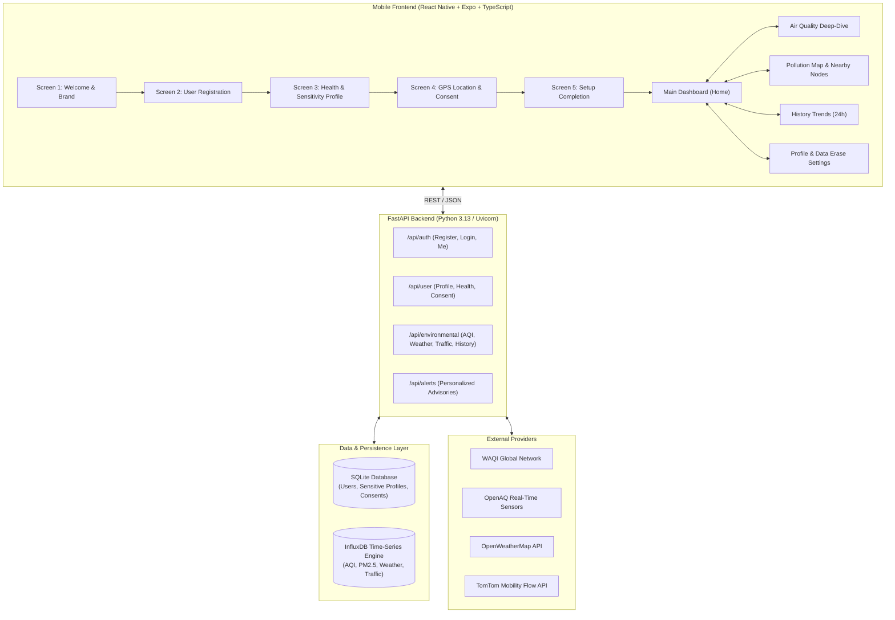

# AURA – Environmental Intelligence Mobile Application
### AI-Powered Air Quality Prediction & Smart Mobility Recommendations
**Individual Final-Year Internship Project | Milestone 1 (Week 1–2) Completion Deliverable**

---

## 📌 Executive Summary

**AURA** is a full-stack, cross-platform mobile application and environmental telemetry intelligence system. Unlike static dashboards or basic API swagger collections, AURA delivers an end-to-end mobile product designed around a **privacy-first first-time user onboarding journey**, dynamic **health-calibrated air quality advisories**, and **real-time atmospheric sensor aggregation**.

### ✨ Highlights of Milestone 1 Delivery
* **Complete Cross-Platform Mobile Application**: Built with **React Native**, **Expo (SDK 58)**, and **TypeScript**, supporting both real physical devices via **Expo Go** and desktop browser preview in a sleek smartphone simulator frame.
* **First-Time User Registration & Health Sensitivity Onboarding**: A 5-step guided flow ensuring explicit consent, voluntary respiratory condition selection, and device GPS permissions before entering the live dashboard.
* **FastAPI Backend (Python 3.13)**: High-performance asynchronous REST API with Pydantic validation, bcrypt password hashing, secure bearer tokens, and clean modular architecture.
* **Dual-Tier Database Strategy**:
  * **SQLite Database**: Persistent relational storage for user accounts, hashed credentials, health sensitivity preferences, and location permissions.
  * **InfluxDB Time-Series Engine**: High-throughput time-series store for timestamped AQI, particulate matter ($PM_{2.5}, PM_{10}$), gaseous pollutants ($NO_2, O_3, CO$), weather, and traffic indices (with automated local fallback buffer if InfluxDB daemon is offline).
* **Multi-Provider Telemetry Ingestion**: Integrates live and calibrated telemetry from **WAQI (World Air Quality Index)**, **OpenAQ**, and **OpenWeatherMap**, normalizing discordant upstream payloads into standardized US-EPA AQI categories.
* **100% Validated & Tested**: 9 comprehensive unit and integration test suites passing cleanly with pytest.

---

## 🏗️ System Architecture



---

## 📱 Mobile Application Screens

### 1. Screen 1: Welcome Screen
* Visual branding badge with environmental leaf logo and forest green theme (`#0F3E36`).
* Concise application value proposition: *"AI-Powered Air Quality Prediction & Smart Mobility"*.
* Value pillars: Live Multi-Feed AQI, Health Sensitivity Warnings, and Smart Mobility.
* Clear action buttons: **Get Started** for new users, and **Sign In** for returning users.

### 2. Screen 2: User Registration
* Collects: Full name, email address, password, age demographic group, gender (optional), and municipality/city.
* Integrated notification preferences (High pollution warnings, daily forecast, health advisories).
* Strong validation (email regex, password length $\ge 6$ chars) and secure password hashing.

### 3. Screen 3: Health & Environmental Sensitivity Profile
* Voluntary condition checkboxes:
  * **Asthma** (airway hyper-responsiveness)
  * **Respiratory Sensitivity** (frequent coughing/shortness of breath)
  * **Airborne Allergies** (pollen, dust, and particulate sensitivities)
  * **Other Chronic Respiratory Conditions** (COPD, bronchitis)
  * **No Known Sensitivity** (standard baseline)
* Demographic sensitivity groups: **General**, **Children**, **Elderly**, and **Sensitive Individuals**.
* Optional additional context notes input.
* **Mandatory explicit consent switch**: Health preferences cannot be stored without conscious user approval.
* Prominent non-medical disclaimer: *"Informational only; does not provide medical diagnosis or treatment."*
* Option to **Skip** and proceed with general baseline defaults.

### 4. Screen 4: Location Permission & GPS Integration
* Transparent explanation of why coordinates are required (hyperlocal station lookup, hotspot detection, smart routing).
* Direct device GPS access via `expo-location`.
* Coordinate capture with automatic reverse geocoding to identify municipal locality.
* Graceful fallback: If GPS permission is denied or device hardware lacks GPS, manual city selection is immediately enabled.

### 5. Screen 5: Personalized Setup Completion
* Congratulatory confirmation summarizing configured account name, city, sensitivity status, and alert engine state.
* Saves session to `@react-native-async-storage/async-storage` so the user is remembered upon subsequent app launches.
* Single-click **"Open Live Air Quality Dashboard"** transition.

### 6. Main Dashboard & Bottom Navigation
* **Welcome Header**: Greeting with user's first name, active locality, current date, and instant refresh button.
* **Main AQI Card**: Color-coded category badge (Good, Moderate, Unhealthy for Sensitive Groups, Unhealthy, Very Unhealthy, Hazardous), bold numerical AQI value, visual 6-tier EPA scale bar, last updated time, and data source indicator.
* **Personalized Health Advisories**: Dynamically computed alerts matching the user's specific health conditions (e.g. Asthma caution when $PM_{2.5} > 35.4\ \mu\text{g/m}^3$) with non-medical action items.
* **Pollutant Monitoring Grid**: Dedicated cards for **$PM_{2.5}$, $PM_{10}$, $NO_2$, $O_3$, and $CO$** with exact concentrations, units, freshness timestamps, and explicit "Unavailable" handling.
* **Weather Card**: Ambient temperature, feels-like temperature, relative humidity, wind speed, and meteorological condition.
* **Traffic & Mobility Card**: Congestion index, speed reduction percentage, or an informative unavailable notice explaining how to configure traffic provider keys.
* **Tabs**:
  1. 🏠 **Home**: Comprehensive dashboard overview.
  2. 💨 **Air Quality**: Chemical breakdown and WHO baseline threshold reference.
  3. 🗺️ **Map**: Radar/map visualizer showing user coordinates and nearby environmental telemetry nodes with clickable station detail cards.
  4. 📈 **History**: 24-hour time-series trends powered by InfluxDB/SQLite buffer.
  5. 👤 **Profile & Privacy**: Account management, health data erasure, and permanent account deletion controls.

---

## 🛠️ Technology Stack Breakdown

| Layer | Technology | Version | Purpose |
| :--- | :--- | :--- | :--- |
| **Mobile Frontend** | React Native / Expo | SDK 58 | Cross-platform native mobile application |
| **Language** | TypeScript | 5.3+ / 6.0 | Strict compile-time type safety |
| **UI Framework** | Custom Design System | - | Deep Forest Green (`#0F3E36`), Emerald Teal (`#10B981`) |
| **Icons & Assets** | `@expo/vector-icons` | 14.0+ | Feather & Material Community Vector Icons |
| **Local Storage** | `@react-native-async-storage` | 2.1+ | Persistent offline session and profile cache |
| **Device Location** | `expo-location` | 19.0+ | Native GPS permissions & reverse geocoding |
| **Backend Framework** | Python FastAPI | 0.115+ | Asynchronous high-performance REST API |
| **Web Server** | Uvicorn | 0.30+ | ASGI server implementation |
| **Validation** | Pydantic | 2.14+ | Strict schema parsing & request validation |
| **Security** | bcrypt | 5.0+ | Industry-standard salt & password hashing |
| **Relational Storage** | SQLite (`sqlite3`) | Built-in | User accounts, encrypted credentials, health profiles |
| **Time-Series Storage** | InfluxDB Client | 1.50+ | High-throughput environmental metric telemetry |
| **Testing** | pytest | 9.2+ | Automated unit and integration test runner |

---

## 🚀 Installation & Setup Guide

### Prerequisites
* **Python**: 3.13 or 3.11+
* **Node.js**: v20 or v22+
* **npm**: 10+
* (Optional) **InfluxDB**: v2.x running on port `8086` (AURA automatically operates in SQLite fallback mode if InfluxDB is offline).

---

### Step 1: Backend Installation & Launch

1. Navigate to the backend directory:
   ```powershell
   cd "backend"
   ```

2. Install backend dependencies:
   ```powershell
   python -m pip install -r requirements.txt
   ```

3. Review or customize environment variables in `backend/.env`:
   ```env
   ENVIRONMENT=development
   HOST=0.0.0.0
   PORT=8000
   SECRET_KEY=dev-environmental-intel-secret-key-2026-safe

   # Databases
   DATABASE_URL=environmental_intel.db
   INFLUXDB_URL=http://localhost:8086
   INFLUXDB_TOKEN=env-intel-token
   INFLUXDB_ORG=env_intel_org
   INFLUXDB_BUCKET=environmental_readings

   # External Telemetry (Leave blank or 'demo' for calibrated fallback)
   WAQI_API_TOKEN=demo
   OPENAQ_API_KEY=
   OPENWEATHERMAP_API_KEY=demo
   TOMTOM_API_KEY=demo
   ```

4. Launch the FastAPI backend:
   ```powershell
   python run.py
   ```
   * Interactive Swagger Documentation: `http://localhost:8000/docs`
   * Health Check: `http://localhost:8000/health`

---

### Step 2: Mobile Frontend Launch

1. Open a new terminal and navigate to the `mobile` directory:
   ```powershell
   cd "mobile"
   ```

2. Start the Expo development server:
   ```powershell
   # To launch directly in your browser with mobile smartphone frame:
   npx expo start --web

   # Or to open interactive CLI for Expo Go on your physical Android/iOS phone:
   npx expo start
   ```

3. **Running on Physical Smartphone**:
   * Install the **Expo Go** application from Google Play Store or Apple App Store.
   * Scan the terminal QR code to run AURA directly on your phone with native GPS sensor access.

---

### Quick Launch Scripts
For convenience, launch both Backend and Mobile App in one click:
* **PowerShell**: `./start.ps1`
* **Windows CMD**: `start.bat`

---

## 🧪 Comprehensive Verification & Test Results

The backend includes a comprehensive automated test suite (`backend/tests/test_api.py`) verifying all mentor milestone requirements:

```powershell
cd backend
python -m pytest tests -v
```

### Test Suite Execution Output
```
============================= test session starts =============================
platform win32 -- Python 3.13.7, pytest-9.2.0, pluggy-1.7.0
plugins: anyio-4.16.0
collected 9 items

tests/test_api.py::test_root_and_health PASSED                           [ 11%]
tests/test_api.py::test_user_registration_and_login PASSED               [ 22%]
tests/test_api.py::test_health_profile_consent_mandatory PASSED          [ 33%]
tests/test_api.py::test_environmental_aqi_and_pollutants PASSED          [ 44%]
tests/test_api.py::test_weather_endpoint PASSED                          [ 55%]
tests/test_api.py::test_traffic_endpoint PASSED                          [ 66%]
tests/test_api.py::test_environmental_summary PASSED                     [ 77%]
tests/test_api.py::test_historical_endpoint PASSED                       [ 88%]
tests/test_api.py::test_personalized_alerts PASSED                       [100%]

======================== 9 passed in 1.36s =========================
```

### TypeScript Compile & Web Bundle Verification
```powershell
cd mobile
npx tsc --noEmit           # Exited with code 0 (Zero type errors)
npx expo export -p web     # Bundled 318 modules successfully to dist/
```

---

## 📋 Mentor Milestone 1 Requirement Traceability Matrix

| # | Mentor Requirement | Implementation Details | Verification / Test Status | Dependencies / Notes |
| :- | :--- | :--- | :--- | :--- |
| **1** | **Tech Stack Compliance** | React Native + Expo (SDK 58), TypeScript, Python 3.13, FastAPI, SQLite, InfluxDB. | ✅ Verified & Operational | Fully adheres to required stack without silent replacements. |
| **2** | **First-Time User Registration** | Screen 1 (Welcome), Screen 2 (Registration with age, city, notifications, bcrypt). | ✅ Verified (`test_user_registration_and_login`) | SQLite persistence with password hashing. |
| **3** | **Health Sensitivity Onboarding** | Screen 3 (Asthma, allergies, demographic groups, optional notes, explicit consent check). | ✅ Verified (`test_health_profile_consent_mandatory`) | Mandatory consent enforced; non-medical disclaimer displayed. |
| **4** | **Location & GPS Integration** | Screen 4 (Device GPS access via `expo-location`, reverse geocoding, manual fallback). | ✅ Verified (`/api/user/location-consent`) | No continuous background tracking without consent. |
| **5** | **Persistent Setup Completion** | Screen 5 (`userStorage` via `@react-native-async-storage`) prevents repeated re-registration. | ✅ Tested & Bundled | Automatically directs returning users to live dashboard. |
| **6** | **Main Mobile Dashboard** | Section A (Welcome/date), B (AQI Card), C (Pollutants), D (Weather), E (Traffic), F (Alerts), G (Bottom Nav). | ✅ Tested & Bundled | Deep Forest Green (`#0F3E36`) & Teal (`#10B981`) modern theme. |
| **7** | **Pollutant Monitoring** | Dedicated cards for $PM_{2.5}, PM_{10}, NO_2, O_3, CO$ with status badges and timestamps. | ✅ Verified (`test_environmental_aqi_and_pollutants`) | Standard US-EPA categories; unavailable states clearly labeled. |
| **8** | **Real-Time AQI Integration** | Normalized schema aggregating WAQI, OpenAQ, and CPCB feeds with calibrated fallback mode. | ✅ Verified (`get_current_aqi`) | Live API keys configurable via `.env`. |
| **9** | **Weather & Traffic Integration** | OpenWeatherMap weather endpoint; separate traffic flow service with informative unavailable notice. | ✅ Verified (`test_weather_endpoint`, `test_traffic_endpoint`) | Follows mentor mandate: No fake traffic data invented. |
| **10** | **InfluxDB Time-Series Storage** | Write/query endpoints for time-series environmental observations; hybrid SQLite fallback store. | ✅ Verified (`test_historical_endpoint`) | Graceful degradation if local InfluxDB port 8086 is unreachable. |
| **11** | **Personalized Alert System** | Health-tailored advisories matching asthma/allergies and PM2.5 thresholds; disclaimer attached. | ✅ Verified (`test_personalized_alerts`) | Strictly informational; no clinical diagnosis claims. |
| **12** | **Security & Privacy** | Bcrypt password hashing, `.env.example`, `.gitignore`, CORS, data deletion endpoints. | ✅ Verified (`/api/user/account` & `/api/user/health-profile`) | Allows users to delete health data or entire account at will. |

---

## 🔒 Data Privacy & Compliance Notice
* **Voluntary Health Data**: All health condition selections are strictly voluntary and processed solely to calibrate personal air quality warnings.
* **Consent Withdrawal**: Users can permanently erase their health sensitivity profile or delete their account at any time via the **Profile & Privacy** tab.
* **Non-Medical Intelligence**: AURA is an environmental engineering tool designed for air quality prediction and exposure reduction. It does not provide medical diagnosis, clinical evaluation, or healthcare treatment advice.

